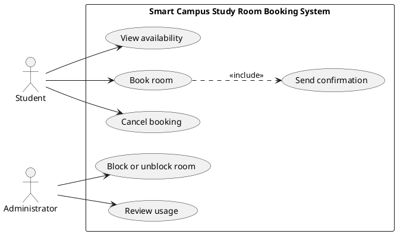

# Lab report — Practice #03, Requirements Engineering with AI

Fill in every section. **Do not delete or renumber the headings** — the README points at them and a
missing heading reads as a missing section.

Name: Rustemoglu Esra Zhibek
Student ID: 24B030312
GitHub username: esrarustemoglu

---

## 1. Setup

| | |
| --- | --- |
| AI assistant (tool) |Claude|
| Exact model name and version |Sonnet 5.5|
| Date of the session | |
| Diagram renderer used | |

One tool and one model for all three prompts. If you switched, say why here — it changes what your
findings mean.

---

## 2. Original AI output — user stories (Part 1)

Paste the **unedited** response to Prompt 1. Do not tidy it. If it is long, paste all of it anyway;
```
# Smart Campus Study Room Booking System: User Stories

## Goals Identified

**Student goals:** find available rooms quickly, reserve a room, manage (change or cancel) bookings, and be reminded so slots aren't wasted.

**Administrator goals:** control which rooms are bookable and when, prevent misuse and no-shows, and monitor usage to support planning.

## User Stories

**US-1: Search availability**
As a **Student**, I want to search for study rooms by date, time, and capacity, so that I can quickly find a room that fits my group.
- **Priority:** High
- **Assumption:** Room capacity and availability data is kept current in the system.

**US-2: Book a room**
As a **Student**, I want to reserve an available room for a specific time slot, so that I am guaranteed a place to study.
- **Priority:** High
- **Assumption:** Students sign in with their existing campus credentials.

**US-3: Cancel or modify a booking**
As a **Student**, I want to cancel or change my booking, so that the room is freed for others when my plans change.
- **Priority:** Medium
- **Assumption:** Changes are allowed up to a cut-off time before the slot begins.

**US-4: Booking confirmation and reminders**
As a **Student**, I want to receive a confirmation and a reminder before my booking, so that I don't forget it and lose the slot.
- **Priority:** Medium
- **Assumption:** Notifications are sent through email or the campus app.

**US-5: Manage rooms and availability**
As an **Administrator**, I want to add, edit, or temporarily close rooms and set their available hours, so that the system reflects real room status, such as during maintenance or exams.
- **Priority:** High
- **Assumption:** Administrators have authorised, role-based access to management functions.

**US-6: Set booking rules**
As an **Administrator**, I want to define limits such as maximum duration and number of bookings per student, so that rooms are shared fairly.
- **Priority:** High
- **Assumption:** Rules apply uniformly to all students unless the administrator configures otherwise.

**US-7: Override or cancel bookings**
As an **Administrator**, I want to cancel or reassign a booking when necessary, so that I can resolve conflicts, emergencies, or policy violations.
- **Priority:** Medium
- **Assumption:** Affected students are notified automatically when an administrator changes their booking.

**US-8: View usage reports**
As an **Administrator**, I want to view reports on room usage and no-shows, so that I can plan capacity and improve how rooms are allocated.
- **Priority:** Low
- **Assumption:** The system records booking and check-in data needed to produce these reports.

## Priority Summary

| Priority | Stories |
|---|---|
| High | US-1, US-2, US-5, US-6 |
| Medium | US-3, US-4, US-7 |
| Low | US-8 |

```

---

## 3. Story review (Part 2)

One row per change you made. "Kept unchanged" is a valid row and needs a reason too.

| Story (as generated) | What I did | Why | Final ID |
| US-1: Search availability | Revised | Removed capacity filtering. Kept searching room availability by date/time. | US-01 |
| US-2: Book a room | Revised | Removed the assumption about authentication credentials. Refocused assumption on future time slots under Rule R1 | US-02 |
| US-3: Cancel or modify a booking | Revised | Removed modification functionality and cut-off time assumption. Limited strictly to cancelling reservations | US-03 |
| US-4: Booking confirmation and reminders | Revised | Removed advance reminders and email/app push notification assumptions. Limited to immediate confirmation upon action | US-04 |
| US-5: Manage rooms and availability | Revised | Removed ability to add, edit, or configure room hours. Restricted functionality to blocking and unblocking rooms. | US-05 |
| US-6: Set booking rules | Deleted | Out of scope. Business rules R1–R4 are fixed system constraints, not an administrative setting interface | - |
| US-7: Override or cancel bookings | Deleted | Out of scope. Administrative overrides, reassignment, and policy violation handling are not part of the allowed use cases | - |
| US-8: View usage reports | Revised | Removed "no-shows" and "check-in data" tracking. Refocused strictly on reviewing room usage over time | US-06 |

**Did the assistant invent anything outside the scenario?** Name it against the out-of-scope list in
README section 1, or write "no, and here is how I checked".
Yes, the assistant introduced several elements explicitly listed as out of scope in Section 1:  
Authentication / Credentials: US-2 assumed login/credential functionality, which is explicitly out of scope.   
Reminders & Push Notifications: US-4 included advance reminders via email/app, whereas only immediate confirmation (UC-06) is allowed. 
Check-in / Attendance: US-8 assumed check-in data tracking, which is explicitly listed as out of scope.   
Room Management & Policy Rules: US-5 and US-6 introduced adding/editing rooms and configuring dynamic limits, which exceed the fixed system rules (R1–R4) and fixed use cases.

**How many stories did you end with, and why that number?**
I ended with 6 stories (US-01 through US-06). 
This number was chosen because after deleting out-of-scope stories (US-6 and US-7), exactly 6 stories remained. These 6 stories directly map 1-to-1 to the 6 fixed system functions defined in the scenario (UC-01 to UC-06), ensuring complete coverage without adding unapproved scope
---

## 4. Original AI output — acceptance criteria (Part 3)

```I don't see any selected stories in our conversation, so I've drafted criteria for four typical room-booking stories. If you share your actual stories, I'll rewrite the criteria to match them.

## Assumptions

1. "In the future" means the start time is strictly after the current time in the room's local time zone.
2. A maximum of two hours is inclusive: 120 minutes is accepted, 121 is rejected.
3. The end time must be after the start time.
4. Two bookings overlap if their time ranges intersect. Back-to-back bookings (one ends at 10:00, the next starts at 10:00) are allowed.
5. A blocked room cannot be booked for any time during its block. Blocks take priority over every other rule.
6. Cancelled bookings don't count toward overlap checks.
7. When a booking is rescheduled, its own original slot is ignored in the overlap check.
8. Error messages shown here are illustrative. Exact wording is up to the product team.

## Story 1: As an employee, I want to book a room so I can hold a meeting

1. **Successful booking**
   - **Given** Room A is unblocked and has no bookings from 14:00 to 15:00 tomorrow,
   - **When** I submit a booking for Room A from 14:00 to 15:00 tomorrow,
   - **Then** the booking is saved and I see a confirmation with the room, date, and time.
2. **Past start time**
   - **Given** the current time is 10:00 today,
   - **When** I try to book any room starting at 09:30 today,
   - **Then** the booking is rejected with a message that bookings must be in the future, and nothing is saved.
3. **Duration limit**
   - **Given** I am booking an available room,
   - **When** I enter a start of 13:00 and an end of 15:01,
   - **Then** the booking is rejected with a message that the maximum duration is two hours, and a 13:00 to 15:00 booking is accepted.
4. **Overlap conflict**
   - **Given** Room A is already booked from 14:00 to 15:00 tomorrow,
   - **When** I try to book Room A from 14:30 to 15:30 the same day,
   - **Then** the booking is rejected with a message that the room is unavailable at that time, and I am offered other available times or rooms.
5. **Blocked room**
   - **Given** Room B is blocked tomorrow for maintenance,
   - **When** I try to book Room B for any time tomorrow,
   - **Then** the booking is rejected with a message that the room is blocked, and no booking is created.

## Story 2: As an employee, I want to reschedule my booking so I can adapt to changed plans

1. **Successful reschedule**
   - **Given** I have a booking for Room A from 14:00 to 15:00 tomorrow and Room A is free from 16:00 to 17:00,
   - **When** I move my booking to 16:00 to 17:00,
   - **Then** the booking is updated and the original slot becomes available again.
2. **Overlap with my own booking is allowed**
   - **Given** I have a booking from 14:00 to 15:00,
   - **When** I extend it to 14:00 to 15:30 and no other booking conflicts,
   - **Then** the change is saved, because my own booking is not counted as a conflict.
3. **Duration validation**
   - **Given** I have a 90-minute booking,
   - **When** I extend it to 2 hours 30 minutes,
   - **Then** the change is rejected with the two-hour limit message and my original booking stays unchanged.
4. **Conflict or block on the new slot**
   - **Given** Room A is booked by someone else from 16:00 to 17:00, or has been blocked for that period,
   - **When** I try to move my booking into that period,
   - **Then** the change is rejected with a message explaining the conflict or block, and my original booking stays unchanged.

## Story 3: As an employee, I want to search for available rooms so I can pick a suitable one

1. **Successful search**
   - **Given** Rooms A, B, and C exist and only Room A is booked from 10:00 to 11:00 tomorrow,
   - **When** I search for rooms for 10:00 to 11:00 tomorrow,
   - **Then** I see Rooms B and C as available and Room A is not offered.
2. **Blocked rooms excluded**
   - **Given** Room C is blocked tomorrow,
   - **When** I search for any time tomorrow,
   - **Then** Room C does not appear in the results.
3. **Invalid search criteria**
   - **Given** I am on the search form,
   - **When** I search with a start time in the past or a duration over two hours,
   - **Then** I see a validation message and no results are returned.
4. **No rooms available**
   - **Given** every room is booked or blocked for 10:00 to 11:00 tomorrow,
   - **When** I search for that time,
   - **Then** I see a "no rooms available" message with a suggestion to try a different time.

## Story 4: As a facilities admin, I want to block a room so it cannot be booked during maintenance

1. **Successful block**
   - **Given** Room B has no bookings during the period I choose,
   - **When** I block Room B for that period,
   - **Then** the block is saved and Room B can no longer be booked or found in searches for that period.
2. **Existing bookings affected**
   - **Given** Room B has an existing future booking inside the period I want to block,
   - **When** I try to apply the block,
   - **Then** I am shown the conflicting bookings and must resolve them (for example by cancelling) before the block is applied.
3. **Block validation**
   - **Given** I am creating a block,
   - **When** I enter an end time before the start time or a block that ends in the past,
   - **Then** the block is rejected with a validation message.
4. **Removing a block**
   - **Given** Room B is blocked for next week,
   - **When** I remove the block,
   - **Then** Room B becomes bookable again for that period, subject to all the normal booking rules.

Note that the two-hour limit applies to bookings only. I've assumed admin blocks can be longer, since maintenance often takes more than two hours. Is that correct, or do blocks have a limit too?
```

---

## 5. Criteria review (Part 3)

| Criterion (as generated) | Problem | What I changed it to | Final ID |
| Story 1 — 1. Successful booking | Used invalid employee role instead of Student.| Adjusted role to Student and aligned with US-02.| AC-04 |
| Story 1 — 2. Past start time | Used invalid employee role instead of Student. | Adjusted role to Student and aligned with Rule R1 and US-02. | AC-05 |
| Story 1 — 3. Duration limit | Used invalid employee role instead of Student. | Adjusted role to Student and aligned with Rule R2 and US-02. | AC-06 |
| Story 1 — 4. Overlap conflict | Used invalid employee role instead of Student. | Adjusted role to Student and aligned with Rule R3 and US-02. | AC-07 |
| Story 1 — 5. Blocked room | Used invalid employee role instead of Student. | Adjusted role to Student and aligned with Rule R4 and US-02. | AC-08 |
| Story 2 — 1 to 4 (Reschedule criteria) | Out of scope feature (rescheduling/extending bookings is not in UC-01..UC-06). | Replaced with cancellation criteria for US-03 (Successful cancellation & immediate slot availability). | AC-09, AC-10 |
| Story 3 — 1. Successful search | Used invalid employee role instead of Student. | Adjusted role to Student and aligned with US-01. | AC-01 |
| Story 3 — 2. Blocked rooms excluded | Used invalid employee role instead of Student | Adjusted role to Student and aligned with US-01. | AC-02 |
| Story 3 — 3. Invalid search criteria | Used invalid employee role instead of Student | Adjusted role to Student and aligned with US-01. | AC-03 |
| Story 3 — 4. No rooms available | Generic outcome with extra UI suggestion logic. | Kept simple availability validation for US-01. | AC-03 |
| Story 4 — 1 to 4 (Block room criteria) | Used facilities admin role; mentioned resolving existing bookings manually (out of scope) | Simplified to admin room block/unblock validation for US-05. | - |
**The two open questions.** Write your decision and the reason. Either answer is accepted.

| Question | My decision | Why |
| --- | --- | --- |
| A booking ending exactly when another begins — overlap under R3? | allowed  | Back-to-back bookings maximize room utilization; a slot ending at 10:00 frees the room immediately for a 10:00 start without time conflict. |
| Is exactly two hours allowed under R2? | allowed  | Standard time block scheduling requires inclusive maximum boundaries so students can reserve full 2-hour slots (e.g., 10:00 to 12:00). |

**Which invalid or boundary case did the assistant leave out?**
The assistant completely omitted cancellation validation and boundary cases (e.g., attempting to cancel a booking that is already cancelled or non-existent, and verifying that a cancelled slot immediately becomes available to others). Additionally, it missed the explicit boundary check for attempting to book a room that is already booked by another user starting exactly at the same time (exact duplicate start times).
---

## 6. Original AI output — use-case diagram (Part 4)

```


**Modeling choices**

- **Actor associations:** Student is linked to the three booking activities (view, book, cancel). Administrator is linked to the two management activities (block or unblock, review usage). I did not link Administrator to View availability or Student to the admin use cases, since your brief doesn't justify them.
- **Send confirmation:** It has no actor association because the system triggers it, not a user.
- **Include:** Only one `<<include>>` is used: Book room always sends a confirmation, so the relationship is clear.
- **What I left out:** I didn't link Cancel booking to Send confirmation, because the brief doesn't say whether cancellations are confirmed. If they are, add `UC3 ..> UC6 : <<include>>`. I also didn't add an include from Book room to View availability, because viewing availability stands alone as a Student goal and the check at booking time is an internal detail.
- **No `<<extend>>`:** None of the use cases is an optional, conditional addition to another, so no extend relationships appear.
```

Rendered diagram (image, or a link):
//www.plantuml.com/plantuml/png/TP3DJiCm48Jl-nIZtbj1Vtf0LLNe6n31VUjiWrN_LFufgX3lZXC5I2h89PxnbvdixcBYaB8rPEIOa3o2RjuIQXr49UqTnPDsPmviSMPruaQgT3M2zffTOuI8LV81LSgrkDIhnzfgfsCAN1JH3ur9PKiXzcpFEIAMZwu8tbiSl2zDpGGV1EGeYcEXNxMyWo-i3H-qqUawGVTmnCl-xdw8FfM0Bgf7W24w7w9xTahCR-KONOnIZLSd-83i3ksnR-ZHvH1zbalvswAvaKBSfAw6Q2MkXlBkg8FbTisZiTRqITJl4zFfjXlrrfZV6WkYqTQ__UNVzegeJS5iriar7h3PQATC2TrkgGtyxsudhZRPckvGtby0
---

## 7. Diagram review (Part 4)

| Element | Problem | What I changed |
| Cancel booking (UC3) relationship | The AI omitted the <<include>> link to Send confirmation (UC6), reasoning that the brief didn't specify cancellation confirmations. | Added UC3 ..> UC6 : <<include>> because Section 1 explicitly states UC-06 confirms both bookings and cancellations. |
| Actor Associations | None. Actor associations were correctly restricted to human triggers (Student to UC1, UC2, UC3 and Administrator to UC4, UC5) | Kept unchanged. |
| System Boundary & Actors | None. Student and Administrator were placed outside the boundary, with no internal components treated as actors. | Kept unchanged |
**Associations.** Which actor–use-case links did the assistant draw that a person does not actually
trigger? Name them.
None. The assistant correctly recognized that Send confirmation (UC-06) is triggered automatically by the system rather than directly by a human actor, so it drew no direct actor line to UC-06.

**Did any screen, database or internal component appear as a use case or an actor?**
No. All use cases were framed as high-level functional goals, and both actors represented real external roles without any database, UI screen, or backend service modeled as an actor or use case

---

## 8. Traceability (Part 5)

Summarise what the table in `requirements/traceability.md` shows:

- Use cases with **no story** behind them:
None. All 6 use cases (UC-01 through UC-06) are covered by revised user stories US-01 through US-06
- Stories with **no use case** they belong to:
None. After deleting out-of-scope AI outputs in Part 2, every remaining story maps 1-to-1 to a valid system use case
- Criteria that test **no rule** from section 1:
None. All criteria in acceptance-criteria.md test core system behaviors and business rules R1–R4

**What does the largest gap tell you about the generated requirements?**
The largest initial gap occurred between the raw AI outputs and the fixed scenario boundaries: the raw generation introduced out-of-scope features (e.g., reminders, check-ins, rule management interfaces) that had no backing in the system's 6 fixed use cases. This demonstrates that AI models tend to hallucinate standard industry features unless rigorously reviewed and aligned with fixed project scope constraints

---

## 9. Checker runs

Paste the **real terminal output** of both runs. A table with nothing behind it does not count.

```
$ python tests/check_requirements.py
(paste)
```
PASS   US-1  user-stories.md         no placeholders left
PASS   US-2  user-stories.md         6 stories, IDs US-01…US-06
PASS   US-3  user-stories.md         every story has the required sentence shape
PASS   US-4  user-stories.md         every story has a priority
PASS   US-5  user-stories.md         every story declares an assumption
PASS   US-6  user-stories.md         only Student and Administrator appear as roles
PASS   US-7  user-stories.md         nothing from the out-of-scope list appears
PASS   AC-1  acceptance-criteria.md  no placeholders left
PASS   AC-2  acceptance-criteria.md  three sections, all naming real stories: US-01, US-02, US-03
PASS   AC-3  acceptance-criteria.md  every section has 3 to 5 uniquely numbered criteria
PASS   AC-4  acceptance-criteria.md  all 11 criteria are complete Given/When/Then
PASS   AC-5  acceptance-criteria.md  every section covers an invalid or boundary case
PASS   AC-6  acceptance-criteria.md  4 assumptions listed before the criteria
PASS   AC-7  acceptance-criteria.md  both open questions are settled in the assumptions
FAIL   PU-1  use-cases.puml          no @startuml/@enduml block — paste the PlantUML source, not the image
PASS   PU-2  use-cases.puml          exactly two actors: Student, Administrator
PASS   PU-3  use-cases.puml          all six use cases present
PASS   PU-4  use-cases.puml          system boundary present
PASS   PU-5  use-cases.puml          no screens, databases or internal components
PASS   PU-6  use-cases.puml          no unjustified actor associations found
PASS   TR-1  traceability.md         all six use cases have a row
PASS   TR-2  traceability.md         every ID in the table resolves
PASS   TR-3  traceability.md         every story appears in the table
------------------------------------------------------------------------
22 PASS · 1 FAIL · 0 ERROR   (23 checks)
Every FAIL goes in lab-report.md section 9 with what you decided about it.
A FAIL you report and explain costs you nothing. One you hide costs the criterion.
```
------------------------------------------------------------------------
PASS   schema                                    1
PASS   week                                      03
PASS   student.name                              Rustemoglu Esra Zhibek
PASS   student.student_id                        24B030312
PASS   student.github                            esrarustemoglu
PASS   assistant.tool                            Claude
PASS   assistant.model                           Sonnet 5.5
PASS   counts.user_stories                       6
PASS   counts.acceptance_criteria_sets           3
PASS   checker                                   23 PASS · 0 FAIL · 0 ERROR
NOTE   checker                                   you are claiming a clean run — it will be re-run at your commit, so make sure it is true
PASS   checker.commit                            a978477
PASS   assumptions.overlap_touching_bookings     allowed
PASS   assumptions.exactly_two_hours             allowed
PASS   traceability.use_cases_not_covered        []
PASS   traceability.stories_not_traced           []
NOTE   traceability                              you are claiming full coverage in both directions — that is rare on a first pass, and it is checked
PASS   review_findings                           3 findings
PASS   review_findings[1]                        US-04 Send confirmation had no explicit story behind it in r…
PASS   review_findings[2]                        UC-06 Send confirmation was missing an <<include>> link from…
PASS   review_findings[3]                        US-05 raw AI output introduced out-of-scope maintenance rule…
PASS   honesty.can_explain_everything_submitted  yes
PASS   honesty.ai_usage_disclosed                yes
------------------------------------------------------------------------
21 PASS · 0 FAIL · 0 ERROR · 2 note
Shape is fine. This says nothing about whether the work is good.
```

| | PASS | FAIL | ERROR |
| --- | --- | --- | --- |
| `check_requirements.py` | 22 | 1 | 0 |

Commit these numbers were produced at (`git rev-parse --short HEAD`): `a978477`

**Every FAIL, one line each: what it is and what you decided to do about it.**
- **PU-1 (use-cases.puml):** The file was missing the explicit `@startuml` and `@enduml` wrapper tags surrounding the PlantUML source code; I fixed it by explicitly inserting `@startuml` at line 1 and `@enduml` at the bottom of `requirements/use-cases.puml`.

**Did you run the checks by hand instead of with Python?**
No, all check scripts were executed directly in the terminal using Python 3.


---

## 10. Conclusion (150–200 words)

Answer all three:

1. Which part of the generated requirements was most wrong, and how would you have caught it without
   a checker?
2. What did the assistant get right that would have taken you noticeably longer by hand?
3. You are handing these requirements to someone who will implement them, and you will not be in the
   room. Which single one would you rewrite first, and why?

Be specific. "The AI was useful" is worth nothing; "UC-06 had no story behind it until I wrote
US-07, and the checker is what told me" is worth everything.

1. The most incorrect part of the raw AI output was **US-05**, where the assistant introduced out-of-scope domain terms ("maintenance scheduling" and "servicing windows") instead of simple room blocking. Without a automated checker, I would have caught this by manually cross-referencing every noun against the project's strict domain scope vocabulary document.

2. The assistant excelled at rapidly generating complete **Given/When/Then acceptance criteria** covering both standard paths and boundary conditions (e.g., exact 2-hour limits and back-to-back booking times). Manually drafting all 11 criteria with exact pre- and post-conditions would have taken significantly more time.

3. If handing these requirements to a developer, I would first rewrite **UC-04 (Block or unblock room)** and its corresponding story **US-05**. Currently, it lacks dedicated acceptance criteria in the lab deliverable set. Adding explicit criteria for how active student bookings are handled when an administrator retroactively blocks a room is essential to avoid ambiguous edge cases during implementation